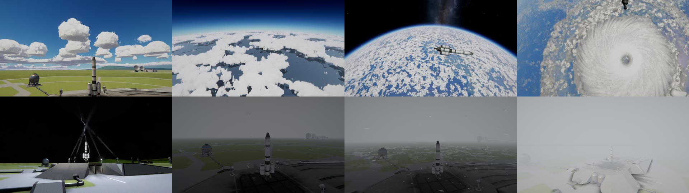
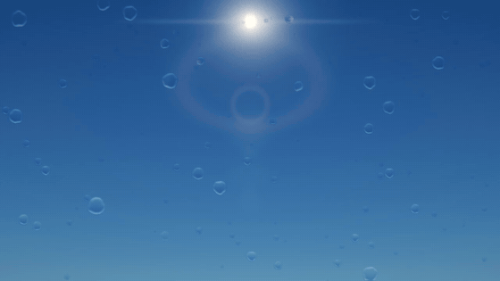

# Natural Weather

Weather that is seen and felt: wind on craft and smoke, clouds that dim the sun, rain and snow, lightning and
thunder, fog and dust storms, hurricanes.

For Kerbal Space Program 1.12.x. **Needs [Keystone](https://github.com/IshiakiZ/ksp-keystone) 0.8 or later**, a separate download
([on SpaceDock](https://spacedock.info/mod/4665/Keystone)): this mod does not load without it.

Three other mods each add one thing, and none is needed: [Natural Light](https://github.com/IshiakiZ/ksp-natural-light) (the light under
cloud; rain, fog and dust veiling the distance), [Volumetric Explosions](https://github.com/IshiakiZ/ksp-volumetric-explosions) (smoke
goes with the wind) and HarmonyKSP (the wind moves craft).

## What it does

* **Wind** with gusts, on craft, parachutes and smoke; downbursts and a storm's air felt by craft.
* **Weather on every world with air**, the same at a given place and time, so it can be forecast: Kerbin's fair days,
  showers and storms, Duna's dust storms, Eve's deck of cloud, Jool's winds.
* **Clouds shaped after photographs:** heaps that grow and fade, banks, towers with anvils; from orbit, fields of
  them. A craft leaves its path through cloud.
* **Rain, snow, freezing rain, ice pellets and hail; fog by kind; lightning** that can strike a craft.
* **Hurricanes, squall lines, tornadoes and waterspouts.**
* **Wet ground, drops on the camera** (a setting), **haloes**, and **icing** on craft in cold cloud (a setting).
* **Launch weather** (a go / no go and a three-hour forecast), or **a real city's weather** at the space centre.

## Install

Copy the `NaturalWeather` folder from the download into your KSP's `GameData`, beside `Keystone`.

## Settings

In the Keystone window: the keystone button on the game's toolbar, or Alt-K (Option-K on a Mac).

## Good to know

* **The newest kinds are first versions:** a tornado's funnel is smooth, a storm's tower can look like a ball from
  afar, fog has no banks with edges. The [wiki](docs/README.md) says what is wrong with each.
* Where another mod already puts wind into the game's aerodynamics (Kerbal Weather Project, Advanced Atmosphere
  Tools), that one wins.
* A city's weather is fetched from Open-Meteo (its name is sent every quarter of an hour; nothing with the box empty).
  Weather data by Open-Meteo.com (CC BY 4.0).

## Works on

Mac: tried. Windows 11 (Direct3D 11 and OpenGL): 0.3 tried; this version built for it, not run there. Linux: never run.

**More:** [the long description](docs/The-long-description.md) (everything in full, and what
was tried on each system) and the rest of the [wiki](docs/README.md).

## Licence

[CC BY 4.0](LICENSE): use it, change it and pass it on as you like, as long as you credit Ishiaki and link back here.
